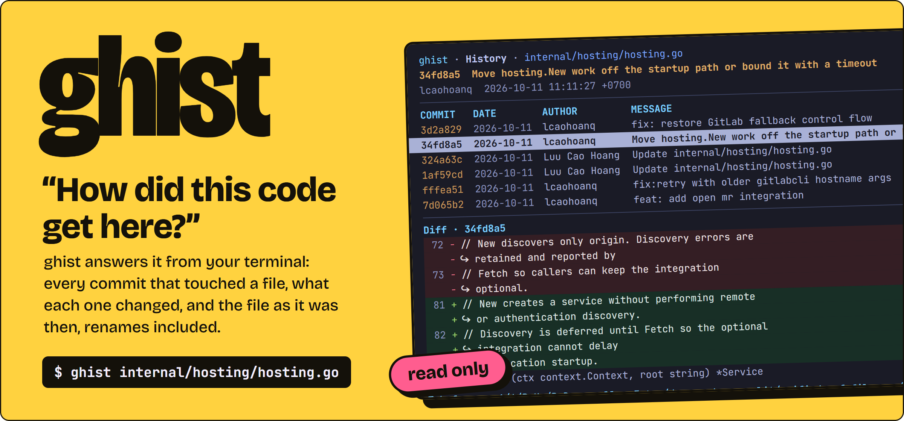
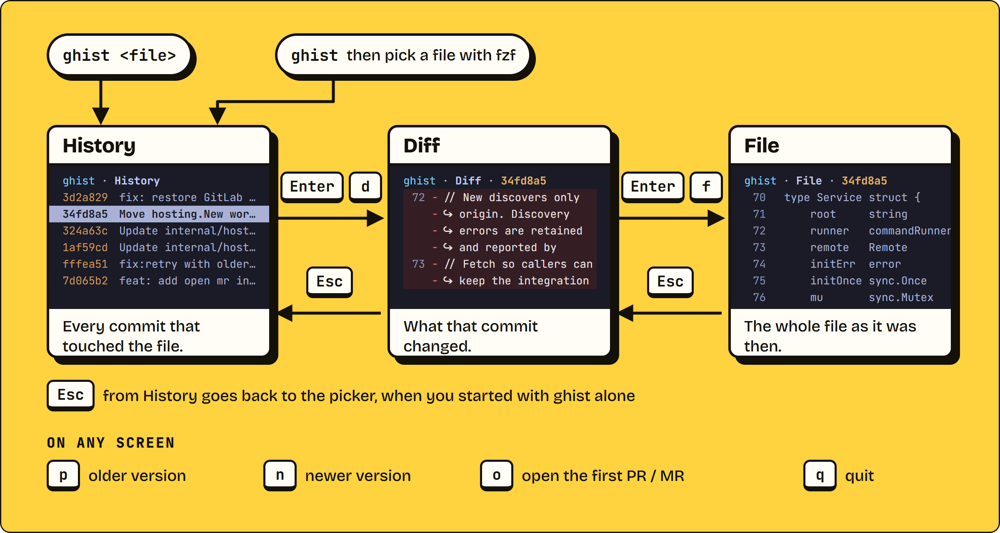
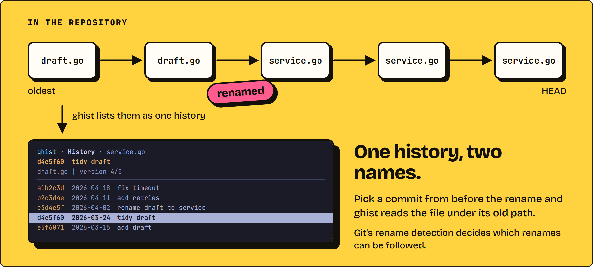
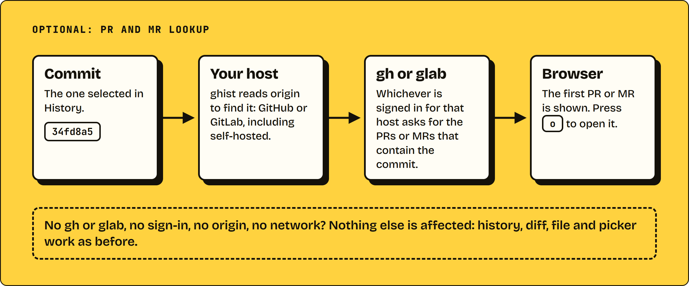

<h1 align="center"><picture><source media="(prefers-color-scheme: dark)" srcset="assets/hero-dark.webp"></picture></h1>

**ghist answers "How did this code get here?" from your terminal.** Pick a file, step back through every commit that touched it, and read what each one changed, renames included. It only reads committed history from HEAD: it never checks out a revision and never touches your files.

## What it looks like


## Operate the workflow

You enter on the history of a file, open the diff of any commit, open the file as it was then, and walk back and forth through its versions with one key each.

<picture><source media="(prefers-color-scheme: dark)" srcset="assets/workflow-dark.webp"></picture>

<details>
<summary>The workflow as text</summary>

1. Start with `ghist <file>`, or run `ghist` alone and choose a file with fzf. Both open the History screen.
2. On History, select a commit. `Enter` or `d` opens its diff. On Diff, `Enter` or `f` opens the whole file as it was at that commit.
3. `Esc` steps back: File to Diff, Diff to History. On History, `Esc` returns to the picker only when you started without a file.
4. On any screen, `p` moves to the older version of the file, `n` to the newer one, `o` opens the first pull request or merge request in a browser, and `q` quits.

</details>

## Follows renames

Git sees a renamed file as two paths; ghist lists one history. Pick a commit from before the rename and it reads the file under its old path.

<picture><source media="(prefers-color-scheme: dark)" srcset="assets/renames-dark.webp"></picture>

## Look, do not touch

ghist only reads. It asks Git for the history, the diffs and the files, and it never checks out a revision or writes a file in your repository. It shows committed history up to the HEAD it read when it opened.

<picture><source media="(prefers-color-scheme: dark)" srcset="assets/readonly-dark.webp"></picture>

## Installation

Install [Go 1.26+](https://go.dev/dl/) and [Git](https://git-scm.com/downloads), then
run the same commands on Linux, macOS, WSL, or **Git Bash on Windows**:

```sh
git clone --depth 1 --branch develop https://github.com/lcaohoanq/ghist.git ~/.ghist
~/.ghist/install
```

```sh
export PATH="$HOME/.local/bin:$PATH"
```

Update an existing installation:

```sh
git -C ~/.ghist pull --ff-only
~/.ghist/install
```

Running ghist requires Git (core tests use 2.55) and an interactive terminal.
[fzf](https://github.com/junegunn/fzf#installation) is optional for file selection;
passing a file works without it. No remote Git service, credentials, or network
connection is needed to load history.

PR/MR lookup is optional. Install and authenticate
[GitHub CLI (`gh`)](https://cli.github.com/) or
[GitLab CLI (`glab`)](https://gitlab.com/gitlab-org/cli) to show reviews for the
selected commit. GitHub.com, GitLab.com, and authenticated self-hosted instances
are supported. A missing CLI, login, `origin`, or network connection never
prevents local history, preview, diff, file, or picker features from working.

<picture><source media="(prefers-color-scheme: dark)" srcset="assets/reviews-dark.webp"></picture>

## Usage

Prefer the editor? The [VS Code extension](extensions/vscode/README.md) adds a
wide **ghist History** tab with a file timeline, local search, PR/MR links, automatic file
following and pinning, native diffs beside it, and read-only historical files. See its README
for local VSIX packaging, installation, and development.

```sh
ghist                            # fuzzy-find a file, then Enter to open history
ghist internal/order/service.go
ghist /absolute/path/to/repo/file.go
ghist -- -filename
ghist --help
```

<details>
<summary>All keys</summary>

| Key | Action |
| --- | --- |
| `↑` / `k`, `↓` / `j` | Select a commit or scroll content |
| `Tab` | Switch focus between history and preview |
| `Enter` | Toggle a focused day header; commit → diff → file |
| `Space`, click day header | Collapse / expand that day group |
| `←`, `→` | Collapse / expand the focused day group |
| `d`, `f` | Open diff or full file |
| `o` | Open the first displayed pull request / merge request in a browser |
| `s` | Toggle split/unified diff (split requires 100 columns in the diff panel) |
| `L` | Load full output when a diff or file exceeds the initial 2 MiB limit |
| `p`, `n` | Older / newer file version |
| `PgUp`, `PgDn`, `Home`, `End` | Page / jump in the list or content |
| `Esc` | File → diff → history → picker (when started without a file); direct-file mode focuses history from preview |
| `q`, `Ctrl+C` | Cancel loading and quit |

</details>

## Development

For interactive hot reload on Linux/macOS, install
[Air](https://github.com/air-verse/air) (tested with v1.67.4):

```sh
go install github.com/air-verse/air@v1.67.4
make dev                              # open the file picker
make dev FILE=internal/tui/view.go
make dev PROJECT=/path/to/repo        # open another project's file picker
make dev PROJECT=/path/to/repo FILE=src/main.go
# Paths containing spaces also work:
make dev FILE="/path/to/repo/my file.go"
```

```sh
make build
make check
```

GitHub Actions runs `make check` (vet and tests with the race detector) and
`make build` on Ubuntu for every push and pull request. The CI workflow uses the
Go version from `go.mod` and can also be started manually from the Actions tab.

<picture><source media="(prefers-color-scheme: dark)" srcset="assets/layers-dark.webp"></picture>

- `internal/git`: Git CLI adapter and repository integration tests.
- `internal/history`: UI-independent data, adapter interface and service.
- `internal/tui`: Bubble Tea v2 state, asynchronous loading and rendering.
- `cmd/ghist`: argument parsing, terminal checks and composition.

The pictures in this README are drawn from HTML in `assets/source/`. The header comment of `assets/source/figures.html` has the command that renders them.
